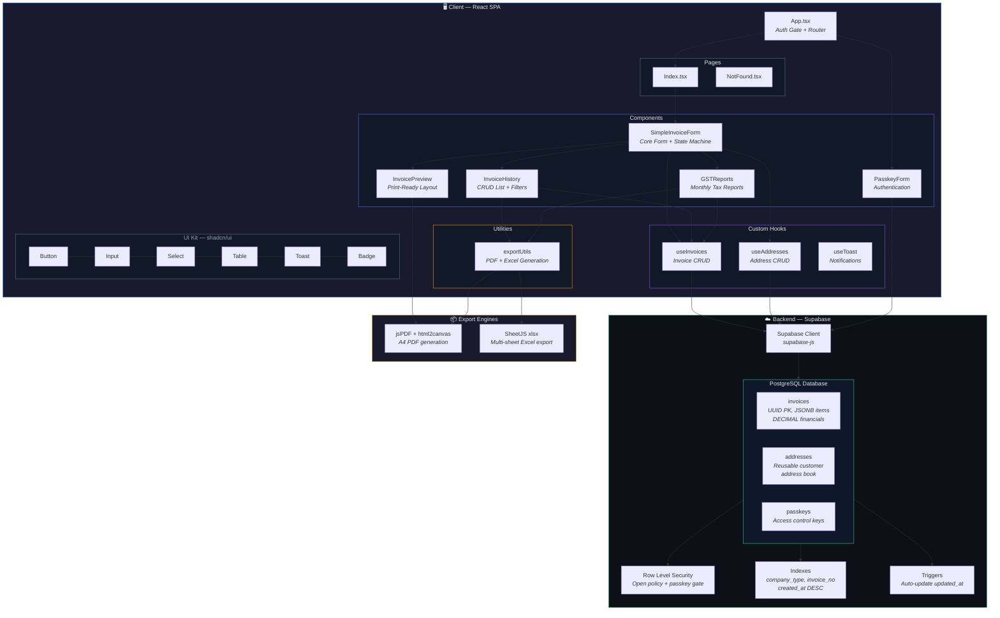
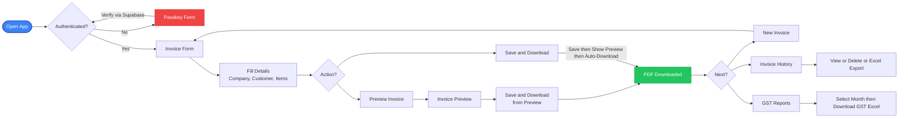
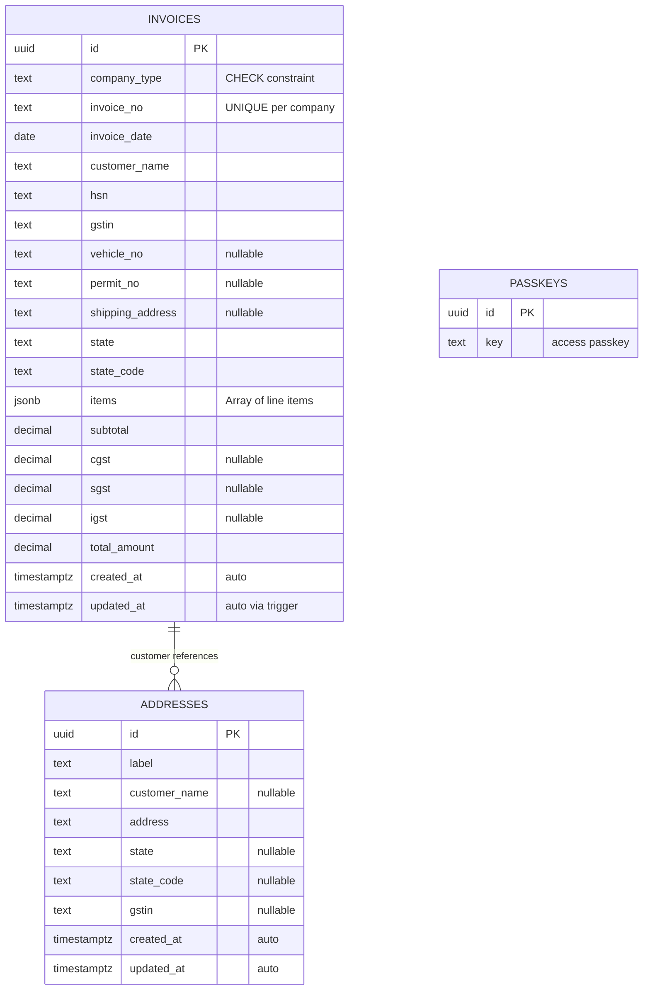

<p align="center">
  
  
  
  
  
</p>

# 📄 BillMate

> **A professional-grade GST Invoice Management System** built for Indian small businesses. Create, save, preview, and export GST-compliant tax invoices — all from a single, elegant dashboard.

---

## ✨ Features

| Category | Features |
|---|---|
| **Invoice Creation** | Multi-company support · Auto-incrementing invoice numbers · Multi-item line entries · HSN code tagging · Vehicle & permit tracking |
| **GST Compliance** | Automatic CGST/SGST (intra-state) & IGST (inter-state) calculation · State code–based tax routing · All 36 Indian states & UTs supported |
| **Export & Download** | One-click **Save & Download** as PDF · Individual Excel export · Bulk Excel export from history |
| **GST Reports** | Monthly CA-ready GST reports · B2B / B2C invoice separation · HSN summary sheet · Tax breakdowns with CGST, SGST, IGST totals |
| **Invoice History** | Full searchable history · Company-wise filtering · View, re-download, or delete past invoices |
| **Address Book** | Save & reuse shipping addresses · Auto-fill customer details, state & GSTIN from saved addresses |
| **Security** | Passkey-protected access gate · Supabase Row Level Security · Persistent login via localStorage |
| **UX** | Dark glassmorphism theme · Fully responsive (mobile-first) · PWA-ready viewport · Bottom navigation on mobile |

---

## 🏗️ System Architecture



---

## 🔄 Application Flow



---

## 📂 Project Structure

```
BillMate/
├── index.html                          # SPA entry point with PWA meta tags
├── vite.config.ts                      # Vite build config with path aliases
├── tailwind.config.ts                  # Tailwind theme with glassmorphism tokens
├── package.json                        # Dependencies and scripts
│
├── supabase/
│   └── migrations/
│       ├── ..._initial.sql             # invoices table + RLS + indexes + triggers
│       ├── ..._unique_constraint.sql   # Unique invoice_no per company
│       └── ..._addresses_table.sql     # Reusable address book table
│
├── src/
│   ├── main.tsx                        # React DOM entry
│   ├── App.tsx                         # Auth gate then Router
│   ├── index.css                       # Global styles + glass design tokens
│   │
│   ├── components/
│   │   ├── ui/                         # shadcn/ui primitives (13 components)
│   │   │   ├── button.tsx
│   │   │   ├── input.tsx
│   │   │   ├── select.tsx
│   │   │   ├── table.tsx
│   │   │   ├── toast.tsx
│   │   │   └── ...
│   │   ├── PasskeyForm.tsx             # Supabase passkey authentication
│   │   ├── SimpleInvoiceForm.tsx       # Main form with all view states
│   │   ├── InvoicePreview.tsx          # Print-ready invoice layout (A4)
│   │   ├── InvoiceHistory.tsx          # History list with CRUD actions
│   │   └── GSTReports.tsx              # Monthly GST report dashboard
│   │
│   ├── hooks/
│   │   ├── useInvoices.ts              # Invoice CRUD + auto-numbering
│   │   ├── useAddresses.ts             # Address book CRUD
│   │   └── use-toast.ts                # Toast notification system
│   │
│   ├── utils/
│   │   └── exportUtils.ts              # PDF generation + Excel exports
│   │                                   #   - downloadPDF()
│   │                                   #   - exportToExcel()
│   │                                   #   - exportAllInvoicesToExcel()
│   │                                   #   - exportMonthlyGSTExcel()
│   │
│   ├── integrations/
│   │   └── supabase/
│   │       ├── client.ts               # Typed Supabase client
│   │       └── types.ts                # Auto-generated DB types
│   │
│   ├── pages/
│   │   ├── Index.tsx                   # Landing page renders SimpleInvoiceForm
│   │   └── NotFound.tsx                # 404 page
│   │
│   └── lib/
│       └── utils.ts                    # cn() helper using clsx + tailwind-merge
│
└── dist/                               # Production build output
```

---

## 🛢️ Database Schema



---

## 🚀 Getting Started

### Prerequisites

- **Node.js** >= 18
- **npm** >= 9
- A **Supabase** project — [supabase.com](https://supabase.com)

### Installation

```bash
# 1. Clone the repository
git clone https://github.com/your-username/BillMate.git
cd BillMate

# 2. Install dependencies
npm install

# 3. Configure environment variables
cp .env.example .env
```

Add your Supabase credentials to `.env`:

```env
VITE_SUPABASE_URL=https://your-project.supabase.co
VITE_SUPABASE_ANON_KEY=your-anon-key-here
```

### Database Setup

Run the SQL migrations in your Supabase SQL Editor in order:

1. `supabase/migrations/..._initial.sql` — Creates `invoices` table with RLS, indexes, and triggers
2. `supabase/migrations/..._unique_constraint.sql` — Adds unique constraint on `(company_type, invoice_no)`
3. `supabase/migrations/..._addresses_table.sql` — Creates `addresses` table

Then insert a passkey:

```sql
INSERT INTO passkeys (key) VALUES ('your-secure-passkey');
```

### Development

```bash
npm run dev        # Start dev server at http://localhost:5173
npm run build      # Production build to dist/
npm run preview    # Preview production build locally
```

---

## 🧰 Tech Stack

| Layer | Technology | Purpose |
|---|---|---|
| **Framework** | React 18 + TypeScript | Component-based UI with type safety |
| **Build Tool** | Vite 5 (SWC) | Fast HMR and optimized production builds |
| **Styling** | Tailwind CSS 3.4 | Utility-first CSS with custom glassmorphism tokens |
| **UI Components** | shadcn/ui + Radix UI | Accessible, composable primitives |
| **Database** | Supabase (PostgreSQL) | Managed Postgres with REST API and Row Level Security |
| **PDF Export** | jsPDF + html2canvas | Client-side A4 PDF generation from DOM |
| **Excel Export** | SheetJS (xlsx) | Multi-sheet Excel workbook generation |
| **State** | React Hooks + TanStack Query | Local state + server state management |
| **Routing** | React Router v6 | Client-side SPA routing |
| **Icons** | Lucide React | Consistent icon library |

---

## 📊 Excel Export Capabilities

BillMate generates four types of Excel exports:

| Export Type | Sheets | Use Case |
|---|---|---|
| **Single Invoice** | 1 sheet with itemized breakdown + tax summary | Attach to individual invoices |
| **All Invoices** | Summary + per-company detailed sheets | Bulk record keeping |
| **Monthly GST Report** | GST Summary, B2B Sales, B2C Sales, HSN Summary | CA-ready monthly filing |

---

## 🔒 Security Model

```
┌─────────────────────────────────────────────┐
│                  Client                     │
│                                             │
│   ┌──────────┐     ┌──────────────────┐     │
│   │ Passkey  │────>│ localStorage     │     │
│   │ Form     │     │ "authenticated"  │     │
│   └──────────┘     └──────────────────┘     │
│        │                                    │
│        v                                    │
│   Supabase .from("passkeys")               │
│   .eq("key", input)                        │
│        │                                    │
└────────│────────────────────────────────────┘
         v
┌─────────────────────────────────────────────┐
│              Supabase Backend               │
│                                             │
│   Row Level Security: USING (true)          │
│   + Client-side passkey verification        │
│                                             │
└─────────────────────────────────────────────┘
```

> **Note**: Authentication uses a simple passkey model suitable for private/internal business tools. For production multi-user apps, consider integrating Supabase Auth with email/password or OAuth.

---

## 📱 Responsive Design

- **Desktop**: Full form layout with side-by-side fields, table-based history
- **Tablet**: Adaptive grid layouts with comfortable touch targets
- **Mobile**: Bottom navigation bar, card-based history, 44px minimum touch targets, safe-area insets for notched devices

---

## 📄 License

This project is private and intended for internal business use.

---

<p align="center">
  Built with ❤️ using React, Supabase & Vite
</p>